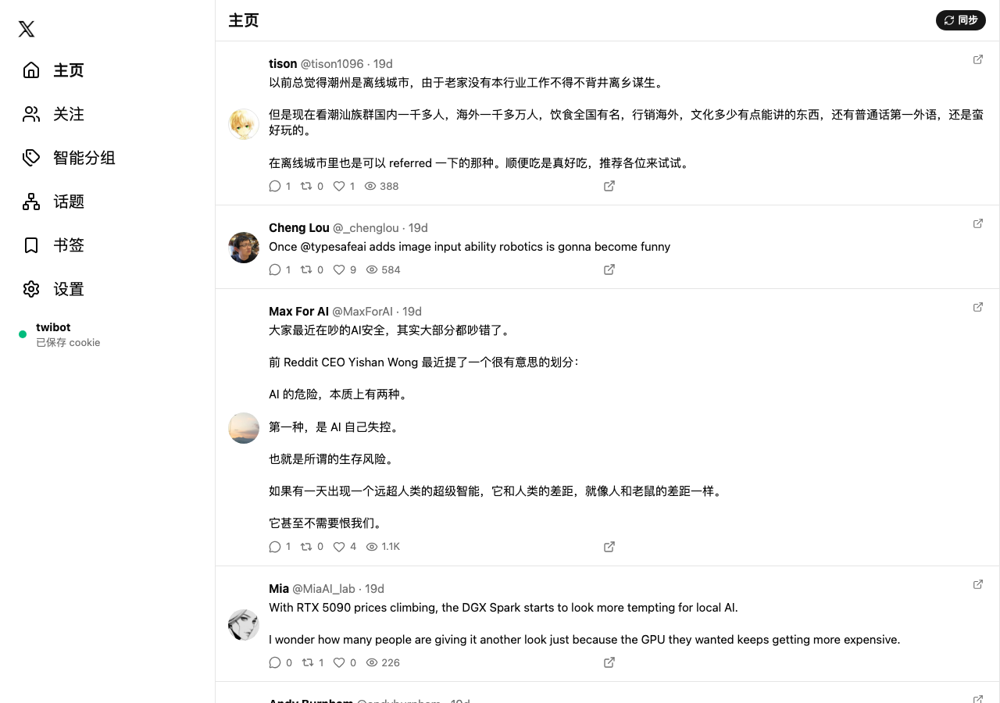

# twibot

> 增强版 X/Twitter 客户端 —— 不用官方 API：用自己的登录态把时间线抓回本地，服务端是一棵 **Cordis 插件树**，Web 与 Android 只是它的两张「脸」，Android 那张还支持**插件热插拔**（改插件不重装 APK）。

<p align="center">
  
  
</p>

---

## English Overview

**twibot** is a self-hosted Twitter/X client. Instead of the official API it drives a real browser
session (Playwright + your own cookies) to pull your timeline, following list, bookmarks and user
pages into a local SQLite database, then serves that database over a small JSON API.

Three faces share one **Cordis plugin tree**: `apps/api` (the plugin host, Node 22 + Hono),
`apps/web` (React 19 + Vite + Tailwind v4) and `apps/android` (Expo SDK 57 / RN 0.86 with a vendored
`cordis-kernel`). The Android shell additionally loads its UI plugins as **remote chunks**: the host
publishes a manifest, the shell hot-swaps a plugin when its `rev` changes — no reinstall, no Metro.

MIT licensed. See the Chinese sections below for architecture, setup and the plugin guides.

---

## 特性

- **无官方 API**：持久化一份 X 登录态（Cookie），用 Playwright 走真实页面抓取——时间线、关注列表、书签、用户主页与其历史推文。
- **本地优先**：所有数据落在本地 SQLite（9 张表）；前端绝大多数操作只读本地库，断网也能翻。
- **Cordis 插件树**：服务端一行 YAML 一个插件（`apps/api/cordis.yml`），插件用 `inject` 声明依赖，`ctx.provide()` 暴露服务；改配置即部署。
- **话题 DAG**：话题 + 父子边（无环由存储层的递归 CTE 在事务内保证）、图搜索与校验，读写都交换**全量图**（前端零补丁、永不漂移）。
- **智能分组**：按关注关系自动分组，支持人工覆盖（`user_group_overrides`）。
- **书签**：抓取 X 书签并分月归档。
- **图片代理**：`pbs.twimg.com` 等白名单域名经 `/api/img-proxy` 转发（大陆网络下必须走代理）。
- **Android 插件热插拔**：壳内核 + 优先级 slot 树 + 远端 chunk（`/plugins/manifest.json` + `*.client.js`），插件按内容寻址的 `rev` 版本化，改插件 15 秒内生效、永不换包。
- **三端同构契约**：所有接口统一信封 `{ ok: true, data } | { ok: false, error: { code, message } }`。

## 架构

```
                        X / twitter.com
                              ▲
                              │ Playwright（Cookie + HTTP 代理）
                              │
┌─────────────────────────────┴──────────────────────────────────────────┐
│ apps/api —— Cordis 插件宿主（Node ≥22.19 / tsx）                        │
│                                                                        │
│  cordis.yml                                                            │
│    ├── core-hello ......... ctx.provide('hello')      （最小示例）      │
│    ├── core-credential .... 登录态读取/写入（data/credential.cookie）   │
│    ├── core-store ......... SQLite（better-sqlite3，自动建表）           │
│    ├── core-session ....... Playwright 会话池（代理 / 限流 / 并发闸门）  │
│    ├── sync-feed .......... 时间线 + 书签抓取          ┐                 │
│    ├── sync-following ..... 关注列表 + 用户推文抓取    ├─ 写库            │
│    ├── smart-groups ....... 自动分组 + 人工覆盖        │                 │
│    ├── core-topics ........ 话题 DAG（图 + 搜索 + 校验）┘                 │
│    ├── api-server ......... Hono HTTP :12000（其余插件都往它上面挂路由） │
│    └── chunk-server ....... GET /plugins/*（远端插件 chunk 静态宿主）    │
└───────────────┬────────────────────────────────────┬───────────────────┘
                │ /api/**  JSON                      │ /plugins/manifest.json
                │                                    │ /plugins/<name>.client.js
     ┌──────────▼───────────┐            ┌───────────▼─────────────────────┐
     │ apps/web  Vite :12001│            │ apps/android  Expo SDK 57       │
     │ React 19 + Tailwind 4│            │ 壳内核 + 优先级 slot 树          │
     │ 自研路由 / 主题三态   │            │ cordis-kernel + 远端 chunk 热插拔│
     └──────────────────────┘            └─────────────────────────────────┘
```

一句话概括 Android 这一侧的野心：**客户端 = 带缓存的投影基座；功能 = 一组插件；插件各自带 rev，后台出新版实时热更新，永不换包。**

## 目录结构

```
apps/
  api/                     Cordis 插件宿主（Node 进程，HTTP :12000）
    cordis.yml             插件清单：一行一个插件（唯一需要编辑的部署文件）
    src/bin.ts             入口：boot('twibot', { configPath })
    data/                  运行期数据（**已 gitignore**：Cookie 与 SQLite 都在这）
  web/                     Web 端（Vite :12001，/api 反代到 127.0.0.1:12000）
    src/components/        FeedView / BookmarksView / TopicsView / TopicPicker ...
    src/lib/api.ts         信封契约客户端（与 Android 侧 api-client 对齐）
    src/lib/router.ts      自研路由（无 react-router）
    test/                  话题图与搜索的纯逻辑单测
  android/                 Android face（Expo SDK 57 + RN 0.86 + cordis-kernel）
    apps/shell/            壳工程（唯一 APK 产物）
      App.tsx              宿主探测 + 装配 + safe-area + 诊断屏
      src/                 壳内核：roster / slot 装配 / chunk 加载 / 清单同步
      src/plugins/         壳自带插件（router / chat-ui / hello / connection / sessions）
      chunks/              远端插件源码（构建成 *.client.js 下发）
      tests/               vitest 单测
    apps/remote-chunk-demo/  老示例插件 + chunk 构建产物目录（dist/ 已 gitignore）
    packages/              face-cordis-kernel / face-priority-slot / face-protocol-client
    scripts/               wifi-deploy.sh（装机）、build-chunk.sh（打包插件）等
packages/
  cordis/ cosmokit/ group/ include/ loader/    Cordis 框架（vendored，MIT）
  plugins/               服务端插件（每个一个包，@twibot/*）
assets/                  README 截图
```

## 快速开始

**要求**：Node ≥ 22.19、pnpm 11（lockfile v9）、一个能访问 `x.com` 的 HTTP 代理（本机监听的
Clash / FastLinkC 之类，下文以 `127.0.0.1:7890` 为例）。

```bash
pnpm install --frozen-lockfile     # 22 个 workspace 工程、约 1290 个包

# 1) 配代理：编辑 apps/api/cordis.yml，把 core-session 与 api-server 的 proxy 改成你自己的
#    proxy: http://127.0.0.1:7890

pnpm dev                           # 同时起：api :12000 + web :12001（只有这两个有 dev 脚本）
```

打开 <http://localhost:12001>：

1. 浏览器登录 `x.com` → DevTools → 任意请求的请求头 → 整段复制 `Cookie:` 的值
   （至少包含 `auth_token` 与 `ct0`）。
2. 粘贴到左侧「设置 → 账号与认证 → 重新粘贴 Cookie」→ 保存。凭据落在
   `apps/api/data/credential.cookie`（**已 gitignore**）。
3. 点右上角「同步」拉时间线；关注 / 书签 / 话题各有自己的同步入口。

## 配置：`apps/api/cordis.yml`

顶层数组，一行一个插件；支持 `id` / `name` / `config` / `inject` / `disabled`，可用 `group` 嵌套。
相对路径以该 YAML 所在目录（`apps/api/`）为锚。**改完重启即可，无需改代码。**

| 插件 | `inject` | 关键配置 | 说明 |
| --- | --- | --- | --- |
| `core-hello` | — | — | 最小示例插件，`provide('hello')` |
| `core-credential` | `api` | `file: data/credential.cookie` | Cookie 读写；来源可为 `env` / `file` / `cdp` / `none` |
| `core-store` | — | `file: data/twibot.db` | SQLite 打开即自动建表 |
| `core-session` | `credential`, `api` | `userAgent`、`proxy`、`minIntervalMs: 6000`、`maxConcurrent: 3` | Playwright 会话池 + 出网代理 + 抓取限流 |
| `sync-feed` | `session`, `store`, `api` | `limit: 20`、`scrolls: 5`、`bookmarkScrolls: 30` | 时间线与书签抓取 |
| `sync-following` | `session`, `store`, `api`, `credential` | `limit: 200`、`scrolls: 8` | 关注列表与用户推文抓取 |
| `smart-groups` | `store`, `api` | — | 自动分组 + 人工覆盖 |
| `core-topics` | `store`, `api` | — | 话题 DAG（无环校验在存储层事务内） |
| `api-server` | `hello` | `port: 12000`、`host`、`proxy` | Hono 宿主；`host: 0.0.0.0` 才可被局域网真机直连 |
| `chunk-server` | `api` | `dir`、`prefix: /plugins` | 远端 chunk 静态宿主，**每次请求现扫目录** |

> ⚠ `host: 0.0.0.0` 会让「持登录态、带 `/sync` 写操作」的 API 暴露给同网段。只在家用 / 可信 WiFi
> 下这么开；要收敛回仅本机就改成 `127.0.0.1` 并重启。

## HTTP API 一览

除 `chunk-server` 外，所有路由都由插件挂在 `api-server` 上，统一前缀 `/api`，统一信封返回。

| 方法 | 路径 | 说明 |
| --- | --- | --- |
| GET | `/api/health` `/api/hello` `/api/inspect` | 健康检查 / 示例服务 / 插件树快照 |
| GET | `/api/img-proxy?url=` | 图片代理（域名白名单） |
| GET | `/api/credential/status` | 登录态状态（`configured` / 来源 / key 列表，不回传值） |
| POST / DELETE | `/api/credential` | 写入 / 清除 Cookie |
| GET | `/api/feed` | 本地时间线 |
| POST | `/api/feed/sync` | 抓取时间线 |
| GET | `/api/following` | 本地关注列表 |
| POST | `/api/following/sync` | 抓取关注列表 |
| GET | `/api/users/:handle` | 用户档案（含其推文） |
| POST | `/api/users/:handle/tweets/sync` | 抓取该用户历史推文 |
| POST | `/api/users/:handle/unfollow` | 取关 |
| GET | `/api/bookmarks` | 本地书签 |
| POST | `/api/bookmarks/sync` | 抓取书签（服务端约 40 s） |
| GET | `/api/groups/auto` · POST `/api/groups/override` | 自动分组结果 / 人工覆盖 |
| GET | `/api/topics` · `/api/topics/:id` · `/api/topics/search` · `/api/topics/validate` | 话题图、详情、搜索、环校验 |
| POST | `/api/topics` | 新建话题 |
| POST / PUT | `/api/topics/:id/parents` | 追加 / 整体替换父边（服务端判环，全量图返回） |
| DELETE | `/api/topics/:id` · `/api/topics/:id/parents/:parentId` | 删话题 / 删单条父边 |
| POST | `/api/batch/user-tweets/sync` · GET `/api/batch/user-tweets/task/:id` | 批量抓取用户推文（任务式） |
| GET | `/api/_stats` | 各表行数 |
| GET | `/plugins/manifest.json` · `/plugins/<name>.client.js` | 远端插件清单 / chunk 代码 |

## 数据库

`apps/api/data/twibot.db`（better-sqlite3，直接 SQL，无 ORM），打开即自动建表：

| 表 | 内容 |
| --- | --- |
| `users` | 用户档案（handle / 昵称 / 头像 / 简介 / 关注数…） |
| `tweets` | 推文正文、媒体、计数、发布时间 |
| `feed` | 时间线顺序（引用 `tweets`） |
| `bookmarks` | 书签（含收藏时间，用于按月导航） |
| `following_rels` | 关注关系 |
| `user_group_overrides` | 人工分组覆盖 |
| `topics` / `topic_edges` | 话题 DAG（节点 / 父子边） |
| `app_kv` | 插件用的键值杂项（如清单 rev 缓存） |

## 插件开发

### 服务端插件

一个插件就是一个 workspace 包，导出 `name` / 可选 `inject` / `apply`：

```ts
// packages/plugins/my-plugin/src/index.ts
import type { Context } from '@deepseek-ai/cordis'

export const name = 'my-plugin'
export const inject = ['store', 'api']          // 依赖的 service，注入完成才 apply

export function apply(ctx: Context, config: { greeting?: string }): void {
  const api = ctx.api as any                     // api-server 提供的 Hono 实例
  api.get('/api/my/hello', (c: any) => c.json({ ok: true, data: { hello: config.greeting ?? 'hi' } }))
}
```

接入四步：① 建包（照抄 `packages/plugins/core-topics/package.json` 的形状：`private`、`type: module`、
`exports: {".": "./src/index.ts"}`、依赖 `@deepseek-ai/cordis: workspace:^`）；② 在 `apps/api/cordis.yml`
里加一行；③ 把 `"@twibot/my-plugin": "workspace:^"` 写进 `apps/api/package.json` 的依赖
（**漏了会在启动期直接 `ERR_MODULE_NOT_FOUND` 炸掉，属于 fail-fast**）；④ `pnpm install && pnpm dev`。

单测放同目录 `*.test.ts`，会被 `pnpm --filter @twibot/api test` 的 glob 收集（`tsx --test`）。

### Android 远端 chunk 插件

壳把远端插件当成「另一种 `materializePlugin` 来源」：下载 → 求值 → 挂 slot。
写的时候就是**普通 TSX**（可以 `import`、可以写 JSX），构建管线把它打成 IIFE 裸脚本 + 一行注册：

```tsx
// apps/android/apps/shell/chunks/my-panel.src.tsx
import { MyPanel } from '../src/components/my-panel'

export function create(env: { slots: unknown }) {
  return {
    name: 'my-panel',
    inject: ['...'],                              // cordis 插件语义，壳内核照常解析
    apply(ctx: any) { /* env.slots.register(...) */ },
  }
}
```

```bash
bash apps/android/scripts/build-chunk.sh my-panel
# → apps/android/apps/remote-chunk-demo/dist/my-panel.client.js  (打印 rev = sha1 前 12 位)
```

约束：`react` / `react-native` / `@react-native-async-storage/async-storage` 由壳的 require 面注入
（esbuild `--external`），其余依赖静态打进 chunk；**壳内核**（`App.tsx`、`src/{roster,modules,plugin-sync,chunk-registry}.ts`）
不在热更范围内——改它必须重打 APK。另外壳只接受 `MODULE_KEYS` 里已有的模块 id（信任名单），
清单里陌生的 id 会被跳过并在诊断屏上记为 `skipped`。

## Android：构建、装机、热更新

### 环境

| 项 | 版本 / 路径 |
| --- | --- |
| JDK | **21**（AGP 对 26 支持存疑；如 `/opt/homebrew/opt/openjdk@21`） |
| Android SDK | `ANDROID_HOME` 指向 SDK 根；需 `platforms;android-36`、`build-tools;36.0.0`、`ndk;27.1.12297006`、`cmake;3.22.1` |
| Gradle | wrapper 9.3.1（`./gradlew` 自带） |
| Node / pnpm | ≥22.19 / 11 |

```bash
export JAVA_HOME=/opt/homebrew/opt/openjdk@21/libexec/openjdk.jdk/Contents/Home
export ANDROID_HOME=/opt/homebrew/share/android-commandlinetools
export PATH="$JAVA_HOME/bin:$ANDROID_HOME/platform-tools:$ANDROID_HOME/emulator:$ANDROID_HOME/cmdline-tools/latest/bin:$PATH"

yes | sdkmanager --sdk_root="$ANDROID_HOME" "platforms;android-36" "build-tools;36.0.0" "ndk;27.1.12297006" "cmake;3.22.1"
```

原生工程目录 `apps/android/apps/shell/android/` 是 **`expo prebuild` 的产物且已 gitignore**，
克隆后若要重建它：`pnpm --filter @twibot/face-shell prebuild`。

> ⚠ **prebuild 之后必须补一行 `hermesCommand`。** 生成的 `app/build.gradle` 里 RN 插件默认用
> `<projectRoot>/node_modules/hermes-compiler/hermesc/<os>-bin/hermesc` 探测编译器，而 pnpm 的严格
> 依赖树在 shell 包下没有这个软链，构建会以 `Couldn't determine Hermesc location` 失败。在
> `react { ... }` 块里加：
>
> ```groovy
> hermesCommand = new File(["node", "--print", "require.resolve('hermes-compiler/package.json', { paths: [require.resolve('react-native/package.json')] })"].execute(null, rootDir).text.trim()).getParentFile().absolutePath + "/hermesc/%OS-BIN%/hermesc"
> ```

### 构建与安装

```bash
cd apps/android/apps/shell/android
./gradlew assembleRelease -PreactNativeArchitectures=arm64-v8a
# → apps/android/apps/shell/android/app/build/outputs/apk/release/app-release.apk（约 26.6 MB）
```

只编 `arm64-v8a`：真机与 arm64 模拟器都是这个 ABI，默认四 ABI 会白等四倍时间。

安装有三条路，脚本 `apps/android/scripts/wifi-deploy.sh` 把常用的都包好了：

```bash
bash apps/android/scripts/wifi-deploy.sh usb          # 有线：reverse + install + 启动（首次最稳）
bash apps/android/scripts/wifi-deploy.sh pair <IP:配对端口> <6位码>   # 无线首次配对（每机一次）
bash apps/android/scripts/wifi-deploy.sh discover     # 之后靠 mDNS 自动找回手机
bash apps/android/scripts/wifi-deploy.sh deploy       # reverse + 安装 + 启动
bash apps/android/scripts/wifi-deploy.sh logs         # ReactNativeJS + 崩溃日志
```

App 侧的宿主地址是**运行时探测**的，按顺序试 `packagerHost()`（debug + Metro 场景）→
`http://127.0.0.1:12000`（adb reverse）→ `http://<构建时填入的局域网 IP>:12000` → `http://10.0.2.2:12000`
（模拟器 NAT），命中即用；全不通会停在 HostPicker 并把试过的地址列出来。局域网地址写在
`apps/android/apps/shell/App.tsx` 的 `LAN_HOST` 常量里（DHCP 变了要么手填、要么改这里重打）。

### 热更新工作流（日常改界面）

```bash
# 1) 改 apps/android/apps/shell/src/**（或 chunks/**）
# 2) 打包成 chunk
bash apps/android/scripts/build-chunk.sh ui-router     # 打印新 rev
# 3) 手机上的 App 每 15 s 拉一次清单，发现 rev 变了就卸旧装新 —— 不重装、不用 Metro、不用重启
```

服务端 `chunk-server` 每次请求现扫目录，所以**重建 chunk 不用重启 API**；手机回到前台时还会补同步一次。
只有动壳内核（`App.tsx` / `src/plugin-sync.ts` / `src/lib/api-client.ts` / `src/modules.ts` 等）才需要重新
`assembleRelease` + 安装。

### 调试技巧

- 界面自证：主 slot 为空时显示诊断屏（宿主地址、roster 每一行的本地/远端 rev、最近 6 条同步结果），
  不依赖日志。
- 命令行的：`wifi-deploy.sh logs`、`adb shell uiautomator dump`、`adb exec-out screencap -p > /tmp/x.png`。
- **保持亮屏**：部分国产 ROM（华为/荣耀的 PowerGenie 等）在锁屏后会冻结进程、掐网络、把轮询间隔拉到
  数分钟，症状是「App 不发请求 / 日志消失」。调试期先 `adb shell svc power stayon true`。
- 真机上可能出现 App 的 `ReactNativeJS` 日志被系统 logd 吞掉的情况（同一 APK 在模拟器上正常），
  所以**服务端请求日志往往是最可靠的观测面**。

## 开发命令

```bash
pnpm dev                        # api + web 并行
pnpm dev:api / pnpm dev:web     # 单独起
pnpm typecheck                  # 根 tsc -b
pnpm --filter @twibot/api test        # 服务端插件单测（node:test）
pnpm --filter @twibot/face-shell test # 壳内核 + 远端 chunk 单测（vitest）
pnpm --filter @twibot/web build       # 前端类型检查 + 产物（apps/web/dist）
```

> `apps/api` 没有自己的 `tsconfig.json`，其 `typecheck` 脚本在干净检出上不成立（历史遗留）；
> 服务端以 `test` 为准。

## 发布

打一个带 APK 的 GitHub Release，一条命令：

```bash
scripts/release.sh 0.1.0                       # 质量门 → 推送 → 构建 APK → 打 tag → 建 Release
scripts/release.sh 0.1.0 --commit "feat: ..."  # 顺手把工作区改动提交掉
scripts/release.sh 0.1.0 --draft --prerelease  # 草稿 / 预发布
DRY_RUN=1 scripts/release.sh 0.1.0             # 只打印将执行的命令，不动任何东西
```

它按顺序做：`pnpm install --frozen-lockfile` → api / face-shell 单测 + 壳 typecheck + web build →
推送当前分支 → `gradlew assembleRelease -PreactNativeArchitectures=arm64-v8a` →
APK 复制到 `dist/release/twibot-face-vX.Y.Z.apk` → `git tag vX.Y.Z` 并推送 →
`gh release create … --generate-notes` 把 APK 作为 Release 资产上传。
`SKIP_TESTS=1` / `SKIP_BUILD=1` / `SKIP_PUSH=1` 可跳过对应步骤。

前置：[gh](https://cli.github.com) 登录过一次即可（`gh auth login`，token 需要 `repo` scope；
若要推送 `.github/workflows/` 里的文件再加 `workflow`）。

> 当前 APK 用 Android **debug 签名**（`CN=Android Debug`），侧载没问题；正式分发前请在
> `apps/android/apps/shell/android` 配 release keystore。

## 常见问题

**抓取全部失败 / `page.goto: net::ERR_TIMED_OUT`** —— 代理没配或配错。`core-session` 与 `api-server`
的 `proxy` 必须指向一个真能访问 `x.com` 的地址；验证：`curl -x http://127.0.0.1:7890 https://x.com`。

**手机连不上后端** —— 三条检查：① `apps/api/cordis.yml` 的 `host` 是否 `0.0.0.0`（或改用
`adb reverse tcp:12000 tcp:12000`）；② 手机与 Mac 是否同一网段；③ `adb reverse` **不持久**，
USB 重枚举 / adb server 重启就没了——App 冷启动时如果隧道还在，会把宿主锁到 `127.0.0.1`，
隧道一断就连不上，这时重启 App 让它重新探测即可。

**手机上一直是认证页 / 主界面空白** —— 多半是插件拿不到正确的 `baseUrl`。远端 roster 行必须继承本地
基线的 `config`（`plugin-sync` 里 `config: baseline.get(id)?.config ?? { baseUrl }`）；漏掉会让插件退回
「只有模拟器能到」的 `10.0.2.2`，表现为：清单轮询正常、数据请求全挂、超时后掉到认证页。

**同步接口超时** —— 抓取是分钟级的（书签 30 轮滚动、每轮 `NAV_TIMEOUT_MS = 30s`），
客户端默认 8 s 超时，只有同步类接口用 `SYNC_TIMEOUT_MS = 180s`。

**`Couldn't determine Hermesc location`** —— 见上文 prebuild 后的 `hermesCommand` 补丁。

**模拟器分辨率太小** —— AVD 定义里改 `hw.lcd.width/height/density`（`~/.android/avd/<name>.avd/config.ini`）；
运行时 `adb shell wm size 1080x1920 && wm density 420` 只是临时的，重启就回到定义值。

**仓库里为什么没有 `docs/`、`data/`、原生工程** —— 见 `.gitignore`：调研文档与运行期数据只在本地留存，
凭据与 SQLite 绝不入库；`apps/android/apps/shell/android/` 是 prebuild 产物。

## 已知限制 / 路线图

- Web 端尚未 cordis 化：Web 是纯前端的另一棵树，插件复用只做到「同构契约」这一层。
- `@callstack/repack` 只留了配置骨架（`repack.config.mjs`），当前打包链路是 Expo Metro；`expo-dev-client`
  未安装，`start: expo start --dev-client` 是坏的（热更走 chunk 通道，不走 Metro）。
- 服务端插件无统一类型检查门（`packages/plugins/*` 没有各自 tsconfig）。
- 抓取强依赖真实页面结构，X 改版可能需要跟着改选择器。

## 致谢

- Cordis / Cosmokit 框架：`packages/{cordis,cosmokit,group,include,loader}` 是
  [deepseek-ai/deepseek-harness](https://github.com/deepseek-ai/deepseek-harness) 中 cordis 的 vendored 副本
  （MIT，Copyright © 2021-present Shigma）。Android 侧的 `face-cordis-kernel` 是它的单文件预打包版。
- 界面组件基于 [shadcn/ui](https://ui.shadcn.com/) 与 [Radix UI](https://www.radix-ui.com/)，
  图标来自 [lucide](https://lucide.dev/)。

## 许可证

[MIT](LICENSE)
